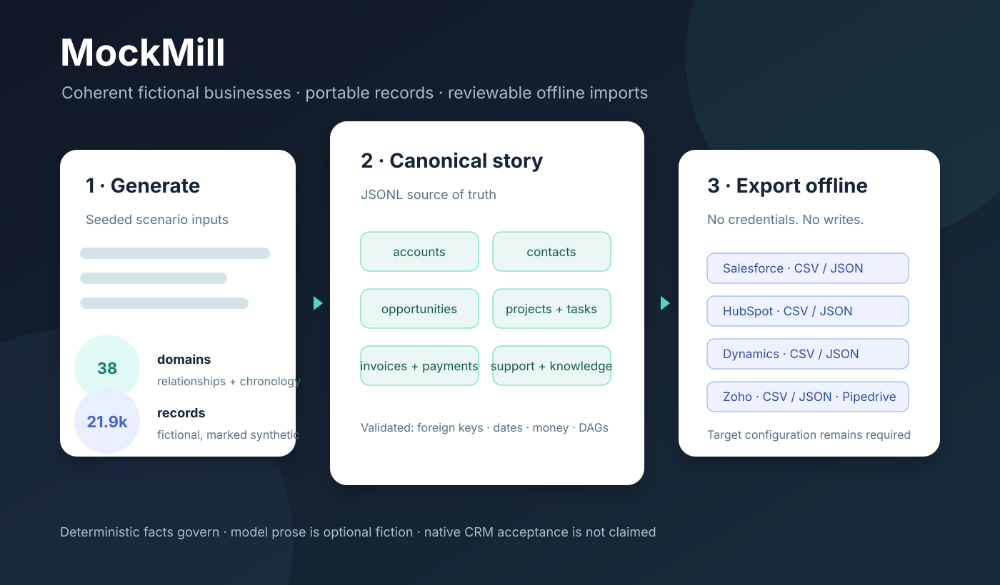
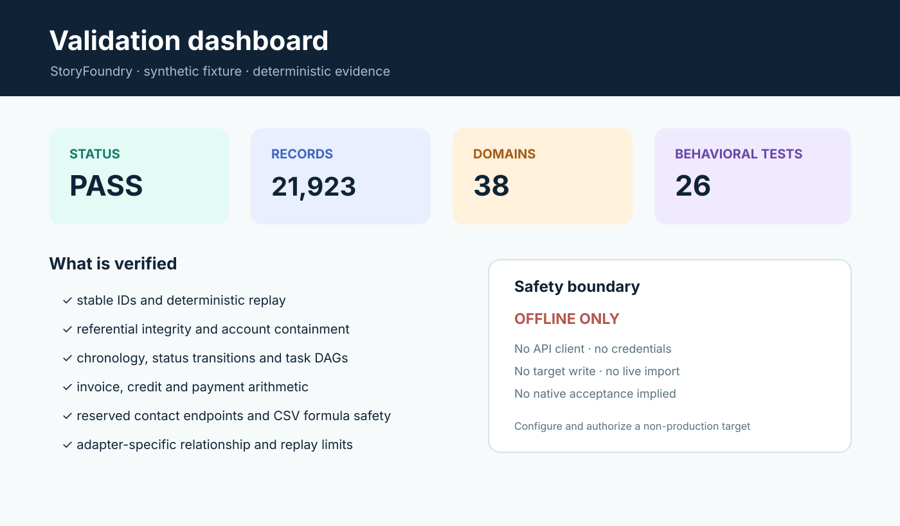
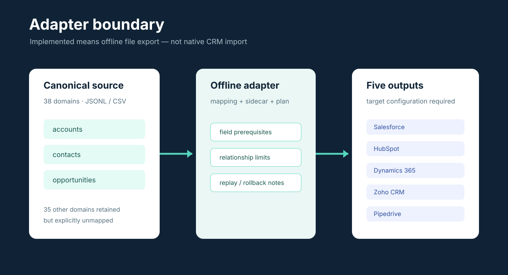

# MockMill visual guide

These diagrams are generated, versioned SVG artifacts. They use only synthetic counts and public-safe product boundaries; they contain no portal screenshots, private records or credentials.

## Parody portrait

[Open the high-detail full-color ASCII portrait](visuals/mockmill-meek-mill-color-ascii.html). This is a character-mosaic transformation of a publicly available promotional portrait for a fan-made parody presentation. It is not official artwork, is not affiliated with or endorsed by Meek Mill, and the original photograph is not bundled here.

The overview explains the product flow, the validation dashboard separates deterministic evidence from the offline safety boundary, and the adapter diagram makes the three mapped object families versus the 35 explicitly unmapped canonical domains visible.
